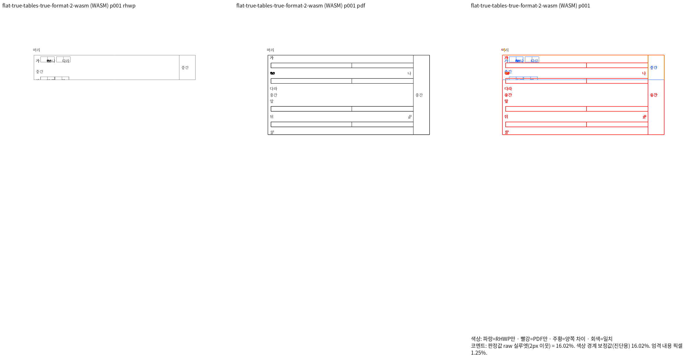
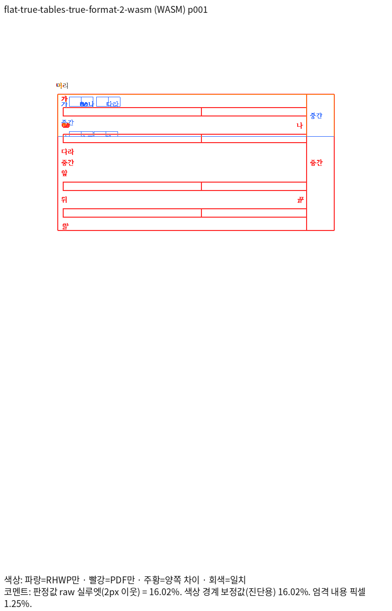

# PR #7833 셀 경계 캐럿 실패 입력의 독립 Print 진단

## 판정과 보존 목적

**미해결 — 제품 출력은 Native/fresh WASM 모두 90% 미만이다.** 이 자료는 기존 실패를
재현하기 위한 음성 증거이며, 정상 fixture·golden·신규 회귀 등록이나 PR 제출 승인의
근거가 아니다. 활성 검사·기대값·제품 코드는 이 단계에서 변경하지 않았다.
진단 모델에서 얻은 수치를 실제 제품 출력의 개선으로 보고하지 않는다.

## 원 해결과 정확한 입력

원 [PR #7833](https://github.com/edwardkim/rhwp/pull/7833)의 공개 head는
`255413cdbc74d34f7c1d1be09fb7ad640eac6feb`이다. 원 커밋
`cbb2d3ee9b702027a8101526fbd2b5f9152603c8`과
`efec7825d325beb5f2eff65ac921f148818367a5`는 각각 누적 브랜치의
`be4e63c903735174ea7960389bd9321cf2704a9e`와
`054d8758b1876e3475ead4d604e3432a156207cd`에 대응한다.
helper 통합 보정은 `9c7cf0445ac07a651f3960cbf57f8cb6a22eac32`다.
원 PR 본문의 미공개 로컬 후보 결과를 이 공개 head의 검증으로 사용하지 않는다.

[원 검사 전체](source-before/cell_boundary_object_cut.rs.txt)와
[생성 helper 전체](source-before/cell_boundary_object_fixture.rs.txt)를 보존한다.
`inline_axis_fixture(flat, true)`를 HWPX로 저장하고 다시 연 입력이다. 두 입력 모두
1쪽이며, 보존 입력을 수정하지 않은 채 MCP의 한컴 2020 Print로 출력했다.
실제 제품 버전은 `11.0.0.9136`, engine `2020`, `pdf_print_method=0`,
`input_preprocess=none`이며 다운로드 바이트는 각각 20431/20513바이트다.

| 입력 | 입력 SHA-256 | PDF SHA-256 | Print job ID |
| --- | --- | --- | --- |
| `flat` | `0581033861bb6316ae6bf0e01be0566eafd3191f62fb06cd590686ee07baf26e` | `157895d08e42e72d3ac26f3e4378a91c5927d9cf70daee0b636fc5def8c2b1e6` | `f5b0d12c-f20a-485f-a771-626c62375e70` |
| `nested` | `9959547e50f0614cb2902fb644008ef268d9f255c8252dd7feb47a4ed5820487` | `11e1a3abc260b1dee8e15937fc8a57b28b1404bcbfcc42c2ddcc572ca60479e2` | `a43cc5c8-50d4-4803-907d-67db641ab649` |

- flat: [HWPX](inputs/flat-true-tables-true-format-2.hwpx) /
  [독립 Print PDF](../../../../pdf/pr7833-cell-axis-diagnostic/flat-true-tables-true-format-2-2020.pdf)
- nested: [HWPX](inputs/flat-false-tables-true-format-2.hwpx) /
  [독립 Print PDF](../../../../pdf/pr7833-cell-axis-diagnostic/flat-false-tables-true-format-2-2020.pdf)

## 현재 제품과 고정 base의 전체 페이지 TSV

검사 source head는 `745f3acbdc182cc7249e623f4f07e9e2b3a70230`, 제품 runtime은
`8dc75860cec88ddf7c3f8aeee230b2ca7e2e5537`이다. Native224와 최적화 fresh WASM063,
Print 프로필·96 DPI·렌더러 compat 2022를 사용했다. 이 compat 값은 한컴 engine이나
설치 연도가 아니다. 글꼴 공급은 `/usr/share/fonts`, `/usr/local/share/fonts`,
`/home/tsjang/.local/share/fonts`, 저장소 `assets/fonts`다.

| 입력 | 고정 base Native | 현재 Native | 현재 fresh WASM |
| --- | ---: | ---: | ---: |
| flat | [15.86207%](tsv/base-native/flat.tsv) | [15.85583%](tsv/native/flat.tsv) | [16.01942%](tsv/wasm/flat.tsv) |
| nested | [19.19125%](tsv/base-native/nested.tsv) | [17.24698%](tsv/native/nested.tsv) | [17.30547%](tsv/wasm/nested.tsv) |

각 TSV는 한 페이지 전체 원문이다. 고정 base는
`9418ed0c7cf289c5c4ac2b3bb8cdc18a1b637a9a`이며 최신 fetch 완료를 뜻하지 않는다.
Native194의 source `60972534680a0c5e51e54ec189b92e252e81a867`과 base의
`src`·Cargo 입력이 같고 보존 source 1507개가 Git blob과 일치함을 확인했다.
같은 Native에서 하락은 각각 0.00624/1.94427%p지만 모두 90% 미만이다.
**fresh base 비교는 아직 실행하지 않았으므로 이 자료만으로 회귀 이관·제거를 판정하지 않는다.**

### 대표 현재 fresh WASM 출력

아래는 진단용 모델이 아니라 변경 없는 실제 제품 출력이다. 작은 표 폭·짧은 부모 셀 때문에
뒤 내용이 잘리며, Print는 큰 셀 그리드를 사용해 줄바꿈하고 부모 표가 더 높다.

[Native flat review](png/native/flat-review.png) / [overlay](png/native/flat-overlay.png),
[Native nested review](png/native/nested-review.png) / [overlay](png/native/nested-overlay.png),
[fresh nested review](png/wasm/nested-review.png) / [overlay](png/wasm/nested-overlay.png)를
같은 입력·독립 PDF로 보존한다. 점수·쪽수만으로 캐럿 소유나 배치 정합을 선언하지 않는다.

Native224 바이너리 SHA-256은
`e333c70587ecf48e24632de8e6f3b843f33eb328051580442af4f46214743ca4`다.
fresh063의 `rhwp.js` / WASM SHA-256은 각각
`75cae6af5d48aa54e2d182681313dc85d824c60ebbea973ab4eb9285807c967d` /
`0995e84e0f2adf6411a517e7f10998a3cbc0929d067d757d8e8ee136637cf4fc`다.

## 진단 관측과 미해결 원인

24개 조회(평면/중첩 × 그림/표 × 메모리/HWP/HWPX × 첫/끝 문단) 중 두 HWPX 표 조건의
끝 문단에서 `cellOverflowed=true`다. 부모 셀 y157.4/h85.5, 캐럿 y216.7/h26.2가
관측됐으며, 이 단계에서 clamp 허용 오차나 논리 offset 기대값을 완화하지 않았다.

합성 helper는 폭 1200HU·높이 1400HU의 Picture 공통 속성을 Table에 통째로 대입하지만,
그 자식 셀 그리드 폭은 41954HU다. 빈 셀의 저장 줄 높이 1000HU와 상하 패딩 합
282HU도 다른 높이 계약이다. 원본의 모순과 렌더러 처리 결함을 구분해야 한다.

같은 PDF의 독립 벡터에서 자식 그리드 폭 약 559.54 CSS px, 높이 약 17.10 CSS px를
관측했다. 부모 clip은 별도 경계이며 표시용 축소 PNG에서 좌표를 역산하지 않았다.
행별 완결 폭 합의가 있는 표만 render-only clone에서 그 폭으로 해석한 실험은
flat 53.10361%, nested 46.44524%다. 이어 선언 높이 하한을 제거하는 진단을 함께
적용했을 때 flat 100.00000%, nested 82.68332%였다. 이는 **제품 미반영 Native 가설**이며
fresh WASM 통과나 원본 출력 보정 완료를 뜻하지 않는다. 높이를 1HU로 바꾼 진단값을
제품 규칙·기대값으로 채택하지 않았다. 깊은 중첩의 앞 문단과 부모 표 하단 차이는 남아 있다.
정상 #5785 대조군은 이 투영에서 변경 0개·PNG 바이트 동일이다.

`Table::flow_width_hu → inline_control_size_hwp / composition / paragraph_layout`의
줄 너비 소비와 `invalid_declared_width_rows → resolve_column_widths`의 그리드 소비를
함께 추적했다. 높이는 `inline_control_occupied_size_hwp → HeightMeasurer`의 측정과
실제 행 높이·부모 표 점유를 함께 대조해야 한다. `layout_embedded_table`은 TextBox에서
호출되므로 현재 입력의 실제 원인 경로라고 단정하지 않는다. render-tree의 wrapper
`CellContext`를 소스 table 주소로 재사용한 중간 진단에도 오인 매핑이 있어 높이 계약의
증거로 채택하지 않았다.

## 재현 기록과 다음 검증

로컬 ignored `output/pr-review/semanticist21-20261019/`의 다음 기록에 실제 명령·producer
SHA와 결과를 보존했다. 실행 로그와 중간 JSON을 이 증적에 추가 커밋하지 않는다.

- `cell-axis-extraction-3643.json`, `cell-axis-observation-3643/observations.json`
- `mcp-cell-axis-3645/results.json`, `cell-axis-models-3647/`
- `cell-axis-current-3649-result.json`, `cell-axis-base-native194-3653-result.json`
- `base-native194-equivalence-3653.json`, `cell-axis-independent-pdf-frames-3654.json`
- `table-projection-score-3651-result.json`, `table-projection-score-3658-result.json`

Native/fresh Sweep은 같은 원본/PDF에 `--file-target <key> <hwpx> <pdf>`,
`--rhwp-bin <동결 Native224> --compat 2022 --dpi 96 --page-workers 1 --out <output>`를
사용했다. fresh는 `--wasm-pkg <최적화 fresh063>`을 추가한 실제 기록을 따른다.
전쪽 TSV는 같은 출력 PNG에 `--silhouette-only --png-pair <rhwp_png> <pdf_png>`로 산출했다.
별도 진단은 같은 PDF 래스터를 재사용했으며 정렬·축척 보정·마스크를 적용하지 않았다.

이 실패 두 입력을 기존 104조건·699쪽 통과 목록에 합치면 106조건·701쪽이지만 전체
범위가 통과한 것이 아니다. 기존 실패 20건 기록은 새 전체 Rust 실행 결과가 아니며,
이번 진단으로 활성 실패가 통과했다고 기록하지 않는다. 공통 조판 계약과 정상 대조군을
확정하고 제품 보정·두 경로 재검증을 마친 뒤에만 정식 회귀와 PR 준비 완료를 판단한다.

- 보존 `tests/cases/cell_boundary_object_cut.rs`: source `745f3acbdc182cc7249e623f4f07e9e2b3a70230`,
  Git blob `1bbfed35fd309e3c7a7a9bb1d6691070d78d1ae7`, SHA-256 `409364a7b7993261f42e3c89eee92de12e5e886188decd8545746bf2e406fde7`.

- 보존 `tests/common/cell_boundary_object_fixture.rs`: source `745f3acbdc182cc7249e623f4f07e9e2b3a70230`,
  Git blob `71b390336b6b0b906b846065f00eaafc66262db4`, SHA-256 `8470987fa153d71419f2fa6277bcddcfe256ee654e3529686d04c4a1d74500f0`.
